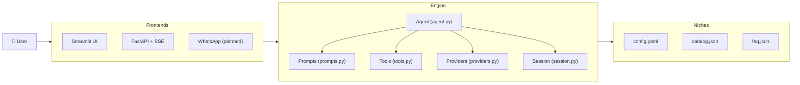

<<<<<<< HEAD
# 🚀 NichePilot

**Niche-switchable AI chat assistant engine for small businesses**


---

NichePilot is a modular, plug-and-play AI chat assistant engine designed for small businesses. Drop in a YAML config, a product catalog, and an FAQ file — and NichePilot instantly spins up a fully functional, niche-aware chatbot that can answer questions, search inventory, capture leads, and hand off to a human when needed. Built for real estate agencies, clinics, restaurants, and any business that needs a smart front-desk assistant.

## ✨ Features

- 🔌 **Plug-and-play niches** — Add a new business vertical by dropping files into a folder
- 🔍 **Smart catalog search** — Filter products/listings by multiple criteria with a single tool call
- 📋 **Lead capture** — Automatically collect and validate customer contact details
- 🤝 **Human handoff** — Seamlessly escalate conversations that need a real person
- 🛡️ **Safety guardrails** — Hard rules prevent prompt injection, off-topic drift, and data leaks
- 💬 **Streaming responses** — Real-time token streaming via SSE for snappy UX
- 🔄 **Dual-provider failover** — Primary + fallback LLM providers for high availability
- 📊 **Qualifying questions** — Guide conversations toward conversion with configurable prompts
- 🖥️ **Multiple frontends** — Streamlit UI for demos, FastAPI for production, WhatsApp-ready architecture

## 🏗️ Architecture



## 🚀 Quick Start

### 1. Clone the repository

```bash
git clone https://github.com/your-org/nichepilot.git
cd nichepilot
```

### 2. Create a virtual environment

```bash
python -m venv .venv
# Windows
.venv\Scripts\activate
# macOS/Linux
source .venv/bin/activate
```

### 3. Install dependencies

```bash
pip install -r requirements.txt
```

### 4. Configure environment variables

```bash
cp .env.example .env
# Edit .env with your API keys
```

### 5. Run the Streamlit UI

```bash
streamlit run app.py
```

The app will open at `http://localhost:8501`. Select a niche from the sidebar and start chatting!

## 📁 Adding a New Niche

Creating a new business vertical takes just 3 files:

1. **Create the niche folder:**
   ```
   niches/
   └── your_niche/
       ├── config.yaml      # Business info, rules, qualifying questions
       ├── catalog.json      # Product/service inventory
       └── faq.json          # Frequently asked questions
   ```

2. **Write `config.yaml`** with your business name, persona, hard rules, and qualifying questions.

3. **Populate `catalog.json`** with your products/services (each item needs an `id`, `status`, and searchable fields).

4. **Add `faq.json`** with Q&A pairs for common customer questions.

5. **Restart the app** — your new niche appears automatically in the sidebar!

See the `niches/real_estate/` folder for a complete working example.

## 🛠️ Tech Stack

| Component | Technology |
|-----------|------------|
| LLM Integration | OpenAI SDK (compatible with Groq, Gemini, etc.) |
| Primary LLM | Groq (Llama 3.3 70B) |
| Fallback LLM | Google Gemini 2.0 Flash |
| Web UI | Streamlit |
| API Server | FastAPI + Uvicorn |
| Data Validation | Custom validators |
| Config Format | YAML + JSON |
| Testing | pytest |
| CI/CD | GitHub Actions |

## 🗺️ Roadmap

- [ ] 📱 WhatsApp Cloud API integration
- [ ] 💬 Instagram DM connector
- [ ] 🗄️ SQLite database for leads (replace CSV)
- [ ] 📊 Admin dashboard for analytics
- [ ] 🌍 Multi-language support (Arabic, French, Hindi)
- [ ] 🔔 Telegram notifications for new leads
- [ ] 📈 Conversation analytics and insights

> [!WARNING]
> ⚠️ **Free API tiers (Groq, Gemini) are for development and demos only.** Do not use free tiers for real client data or production workloads. Rate limits, data retention policies, and reliability are not suitable for production use. Always use paid API plans for live deployments.

## 📄 License

This project is licensed under the MIT License — see the [LICENSE](LICENSE) file for details.
=======
# NichePilot
>>>>>>> ca70bdee09ab836f238585c3feff11b1ad7ae88a
